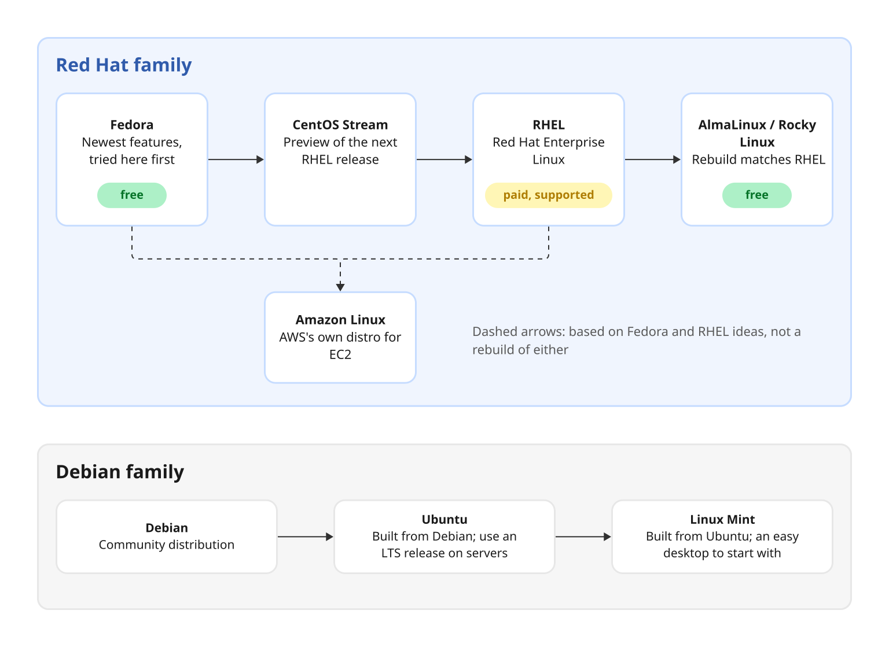
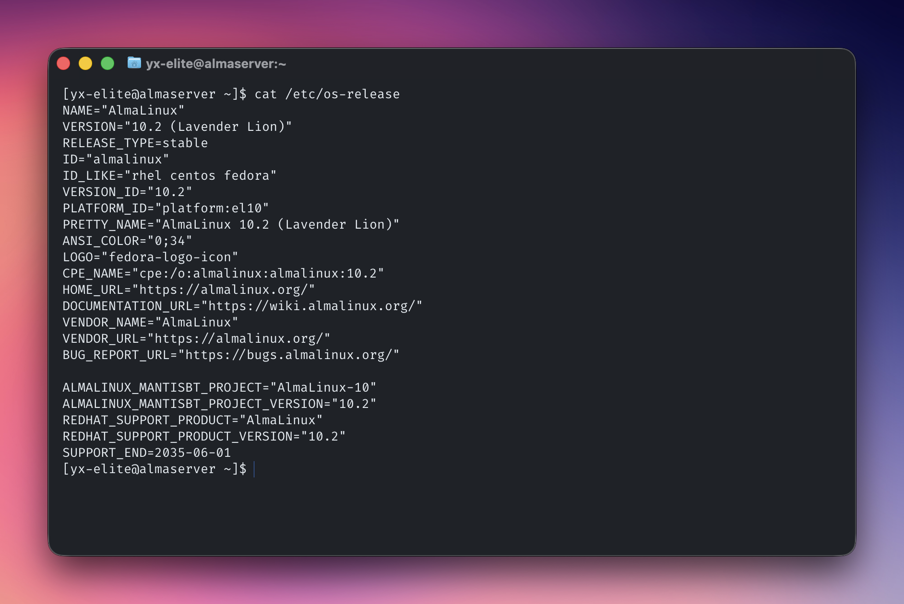
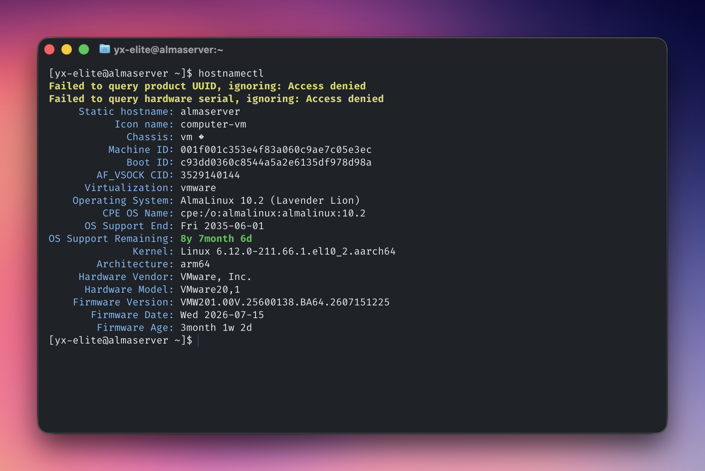
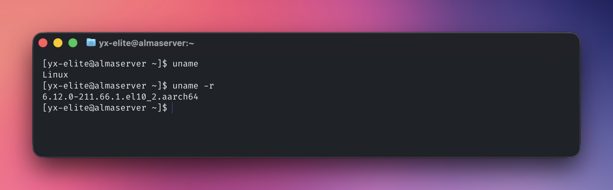
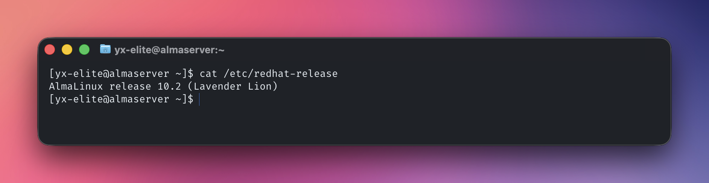
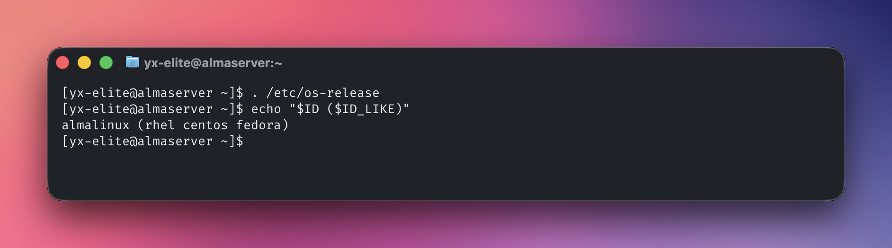

# Linux Distributions

A Linux **distribution** (distro, sometimes called a *flavor*) is the Linux kernel plus a set of tools, a package manager and default settings, packed together so it is ready to install and use. In short: a distribution is the kernel plus software.

## Key ideas

Linux itself is only the **kernel**, the core that talks to the hardware. Everything else you use, such as the shell, the commands, the package manager and the desktop, is added by the distribution. When people say "the Linux OS", they really mean a distribution. Each distribution team chooses which software to include and how to set it up.

All distributions share the same basics:

- the same kernel
- mostly the same commands
- the same directory layout

The real differences are smaller than they look:

- **Package manager:** the biggest difference, covered in the families below.
- **Configuration paths:** some files live in different places.
- **Service names:** for example, the Apache web server is `httpd` on Red Hat but `apache2` on Ubuntu.

### The main families

Distributions come in families. Learn one member of each large family and you can work on almost any server.

| Family | Common distributions | Packages | Package tools |
| --- | --- | --- | --- |
| Red Hat | RHEL, AlmaLinux, Rocky Linux, Fedora, CentOS Stream, Amazon Linux | `.rpm` | `dnf` (older: `yum`), `rpm` |
| Debian | Debian, Ubuntu, Linux Mint | `.deb` | `apt`, `dpkg` |
| SUSE | SUSE Linux Enterprise (SLES), openSUSE | `.rpm` | `zypper` |
| Arch | Arch Linux, Manjaro | `.pkg.tar.zst` | `pacman` |

Where you are likely to meet each family:

- **Red Hat:** companies, data centres and AWS.
- **Debian:** cloud servers, desktops and startups.
- **SUSE:** some enterprises and SAP systems.
- **Arch:** personal desktops and hobby use.

### The two big server distributions

For servers at work, two names come up again and again:

- **Red Hat Enterprise Linux (RHEL):** big, traditional companies such as banks, airlines, telecoms and healthcare.
- **Ubuntu:** newer, fast-moving companies such as startups, SaaS businesses, social networks and cloud-based services.

This is why the lab for this repo uses **AlmaLinux**, a free match for RHEL, and **Ubuntu**.

### Desktop and hobby distributions

Linux is not only for business. Distributions often used on personal computers include Linux Mint, Debian, Fedora, openSUSE, Arch Linux, Mageia and Slackware.

### How the Red Hat family fits together

- **Fedora:** the fast-moving version with the newest features. New ideas are tried here first.
- **CentOS Stream:** a preview of the next RHEL minor release. It sits *ahead* of RHEL, so it is not a copy of it.
- **RHEL:** the paid, supported version used by companies.
- **AlmaLinux and Rocky Linux:** free rebuilds that aim to match RHEL. Good for learning RHEL skills without paying.
- **Amazon Linux:** AWS's own distribution for EC2, based on Fedora and RHEL ideas.

> [!TIP]
> On newer Red Hat distributions, `yum` now points to `dnf`, so both commands work. Prefer `dnf`.

> [!IMPORTANT]
> **CentOS Linux has ended.** Older courses describe CentOS as RHEL without the Red Hat branding, a free copy of RHEL. That was true until CentOS 8 ended in 2021 and CentOS 7 in 2024. AlmaLinux and Rocky Linux now fill that role.

The Debian family is built up the same way: Ubuntu is built from Debian, and Linux Mint is built from Ubuntu.



### Paid and free

- **Commercial** (RHEL, SLES, Ubuntu Pro): you pay for support, certified software and long-term updates.
- **Community** (AlmaLinux, Rocky Linux, Debian, Ubuntu, Fedora): free, and supported by the community.

### Which one to pick

- **Use what your current or target job uses.** This beats any other rule. Banks and large enterprises tend to use the RHEL family; startups and cloud-native teams tend to use Ubuntu.
- **For server and cloud work, learn one RHEL-type distribution and Ubuntu.** AlmaLinux and Ubuntu together cover most servers you will see.
- **On Ubuntu servers, use an LTS release** such as 24.04. LTS releases get about 5 years of updates; other releases get only about 9 months.
- **For a desktop,** Ubuntu, Linux Mint and Fedora are easy places to start.

## Examples

These show which distribution and version a machine is running. They were run on the AlmaLinux lab VM.

### Read the release file

```bash
cat /etc/os-release
```



The useful lines in the output are:

- `NAME` and `VERSION`: the distribution name and version.
- `ID`: a short name, such as `almalinux`, `ubuntu` or `amzn`.
- `ID_LIKE`: the family it belongs to, such as `rhel centos fedora`.

This file exists on almost every modern distribution, so it is the first thing to check on an unknown machine.

### See the OS, kernel and hostname together

```bash
hostnamectl
```



`hostnamectl` puts the hostname, operating system and kernel on one screen. The useful lines in the output are:

- `Static hostname`: the machine's name.
- `Operating System`, `Kernel` and `Architecture`: the distribution, the kernel version and the CPU type (`arm64` here, because the lab runs on Apple Silicon).
- `Virtualization`: shows `vmware` here, so this is a virtual machine. On a physical server the line is missing.
- `OS Support End`: the date this release stops getting updates.

> [!NOTE]
> The two "Access denied" warnings are normal without `sudo`: the hardware UUID and serial number can only be read by root. Run `sudo hostnamectl` to see them.

### Check the kernel name and version

```bash
uname
uname -r
```



On its own, `uname` prints only `Linux`, the kernel name. `uname -r` prints the kernel version, which is useful when a driver or a guide needs a specific kernel:

- `6.12.0-211.66.1`: the kernel version and the distribution's build number.
- `el10_2`: built for Enterprise Linux 10.2, the RHEL release that AlmaLinux 10.2 matches.
- `aarch64`: 64-bit ARM, the same CPU type that `hostnamectl` calls `arm64`.

### Read the Red Hat release file

```bash
cat /etc/redhat-release
```



This prints one line with the release name, here `AlmaLinux release 10.2 (Lavender Lion)`. The file exists only on the Red Hat family, so on Ubuntu it is missing.

### Read the release details on Debian and Ubuntu

```bash
lsb_release -a
```

This shows the distributor, release and codename. It is usually installed on Ubuntu, but on other distributions it may need installing first.

### Pick the package manager in a script

`ID_LIKE` is handy in scripts that need to decide whether to use `dnf` or `apt`:

```bash
. /etc/os-release
echo "$ID ($ID_LIKE)"
```



The first line loads the file's values as shell variables, so `$ID` and `$ID_LIKE` can be used directly. Here `ID_LIKE` contains `rhel`, so a script would pick `dnf`.

## Related

- [Linux directory structure](../02-filesystem/directory-structure.md): the layout every distribution shares
- [Welcome to the shell](../03-shell/welcome-to-the-shell.md): why the prompt looks different on AlmaLinux and Ubuntu

## References

- [DistroWatch](https://distrowatch.com): a list of distributions and news about them
- [AlmaLinux](https://almalinux.org) · [Ubuntu Server](https://ubuntu.com/server)
