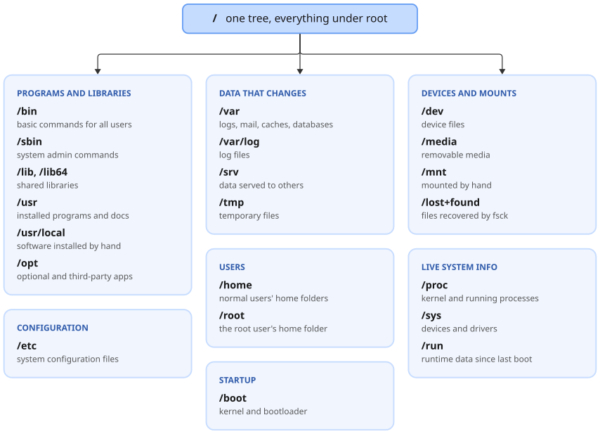
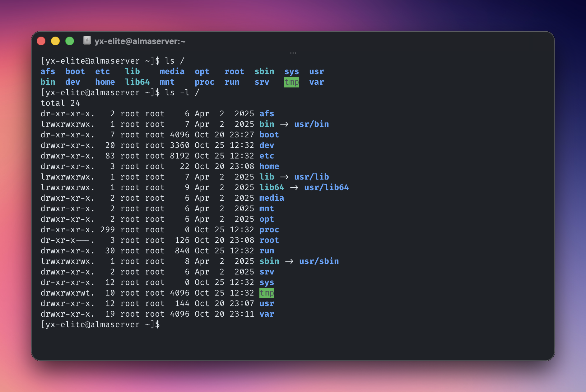
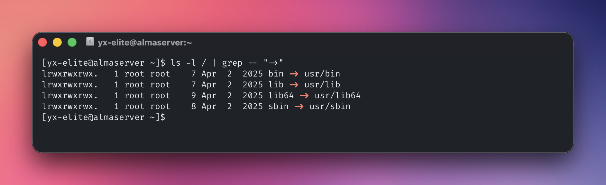
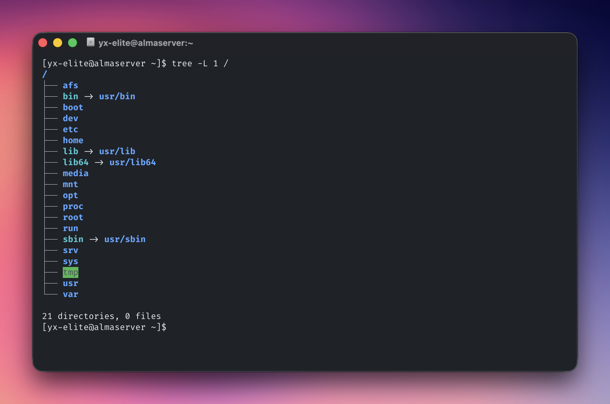
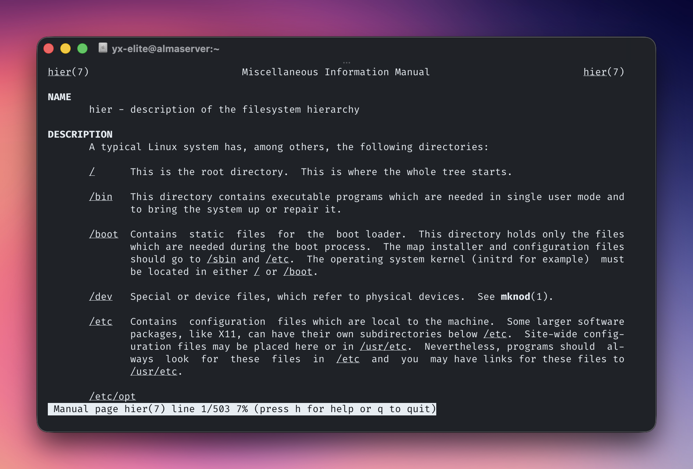
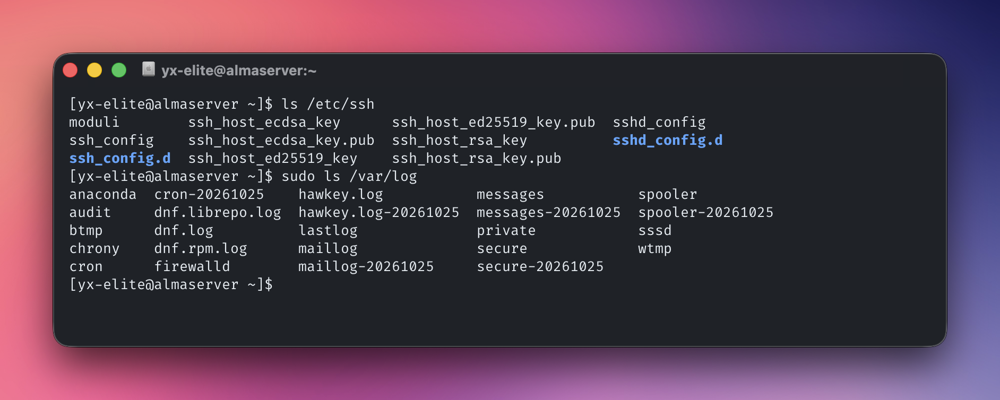
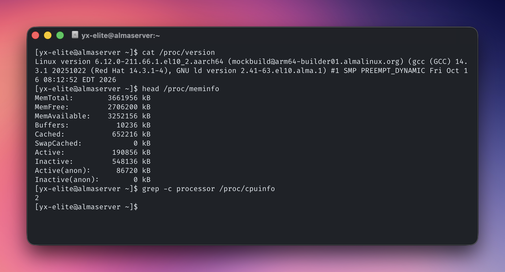
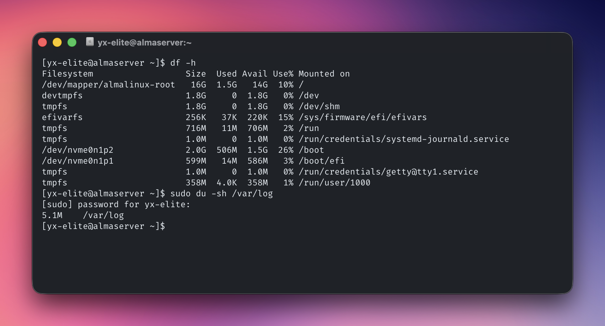

# Linux Directory Structure

Linux keeps everything in a single tree that starts at `/`, called "root". There are no drive letters like `C:\`. Extra disks and USB drives are attached as folders somewhere inside this tree.

Knowing the layout answers everyday questions quickly:

- *Where are the programs?*
- *Where do the configuration files live?*
- *Where are this application's logs?*

## Key ideas

The layout follows the **Filesystem Hierarchy Standard (FHS)**, so most distributions look almost the same. Linux inherited this layout from Unix, so other Unix-like systems such as macOS have a very similar tree. Paths use forward slashes, for example `/home/yx-elite/notes.txt`.

In Linux, everything is a file. Normal files, folders, devices such as disks and terminals, and even live system information all appear as files in the tree.

### Types of files

Files fall into three main types, depending on what they are for.

- **General files:** also called ordinary or regular files. Text, images, videos and programs, stored as plain text (ASCII) or binary.
- **Directory files:** folders. A directory holds other files, including more directories (subdirectories).
- **Device files:** hardware shown as a file. Where Windows gives a disk a drive letter like `D:`, Linux shows it as a file such as `/dev/sda`, and its partitions as `/dev/sda1`, `/dev/sda2` and so on.

`ls -l` shows the type as the first character of each line: `-` for a general file, `d` for a directory, `b` or `c` for a device, and `l` for a symbolic link.

### Common directories

These are the eight top-level directories a normal user works with day to day.

- `/`: the top of the tree. Every other directory sits under it.
- `/bin`: basic commands for all users.
- `/etc`: system-wide configuration files.
- `/home`: home directories for normal users.
- `/opt`: optional and third-party software.
- `/tmp`: temporary files, often cleared on reboot.
- `/usr`: installed programs, libraries and documentation.
- `/var`: data that changes, most notably log files.

### Full directory listing

This is the complete list of top-level directories on a modern Linux system, grouped by what they hold, with the subdirectories and files inside each one that come up most often. Many of them are rarely touched, so this list is for skimming and coming back to when needed.



#### Programs and libraries

- `/bin`: basic commands for all users, such as `ls`, `cp` and `cat`.
- `/sbin`: system administration commands, such as `fdisk`, `reboot` and `ip`.
- `/lib`, `/lib64`: shared libraries needed by programs in `/bin` and `/sbin`.
- `/usr`: installed programs, libraries and documentation. Usually the largest directory.
  - `/usr/bin`: most user commands.
  - `/usr/sbin`: administration commands for the root user.
  - `/usr/lib`: shared libraries used by the programs in `/usr/bin` and `/usr/sbin`.
  - `/usr/include`: header files for compiling C programs.
  - `/usr/share`: data that does not depend on the CPU type, such as documentation (`/usr/share/doc`) and manual pages (`/usr/share/man`).
  - `/usr/local`: software installed by hand, outside the package manager.
- `/opt`: optional and third-party software, each in its own folder (`/opt/myapp`).

> [!NOTE]
> On modern distributions, `/bin`, `/sbin`, `/lib` and `/lib64` are symlinks into `/usr`, known as the "usr merge". Older guides that treat them as separate directories still work, because the links point to the same files.

#### Configuration

- `/etc`: system-wide configuration files. The ones opened most often:
  - `/etc/passwd`: user accounts, such as names, user IDs and home directories. Passwords are not here, they are in `/etc/shadow`, which only root can read.
  - `/etc/group`: groups and their members.
  - `/etc/hosts`: hostnames mapped to IP addresses by hand, checked before DNS.
  - `/etc/resolv.conf`: the DNS servers the system uses.
  - `/etc/crontab`: commands scheduled to run automatically at set times.
  - `/etc/profile`, `/etc/profile.d/`: environment settings applied to every user at login.
  - `/etc/bashrc` (RHEL) or `/etc/bash.bashrc` (Ubuntu): default Bash settings and aliases for every user.
  - `/etc/default/grub`: the editable GRUB settings, such as the menu timeout and kernel options.
  - `/etc/fstab`: disks and the directories they are mounted on at boot.

> [!WARNING]
> A mistake in `/etc/fstab` can stop the system from booting. Check it with `sudo mount -a` before rebooting.

#### Users

- `/home`: home directories for normal users, such as `/home/yx-elite`.
- `/root`: home directory of the root user.

`/` and `/root` are different places. `/` is the root *directory*, while `/root` is the root *user's* home directory.

#### Data that changes

- `/var`: data that changes, such as logs, mail, caches, websites and databases.
  - `/var/log`: log files.
  - `/var/log/messages` (RHEL) or `/var/log/syslog` (Ubuntu): general system messages.
  - `/var/log/secure` (RHEL) or `/var/log/auth.log` (Ubuntu): logins, `sudo` use and other security events.
  - `/var/log/wtmp`: the history of logins and logouts. It is binary, so read it with `last`.
  - `/var/log/lastlog`: the last login of each user. Read it with `lastlog`.
- `/srv`: data the server provides to others, such as web or FTP files.
- `/tmp`: temporary files that any user can write.

On systemd-based distributions many messages go to the systemd journal instead of these text files, and are read with `journalctl`. Some distributions, including recent Fedora and Ubuntu releases, may not write `messages` or `syslog` at all.

A full root filesystem (`/`) or `/var` makes services fail. Old files in `/var/log` are a common cause, so check there first.

> [!WARNING]
> `/tmp` can be cleaned automatically or wiped on reboot. Do not keep anything important there.

#### Startup

- `/boot`: files needed to start the system.
  - `/boot/vmlinuz-<version>`: the Linux kernel itself, one file per installed kernel.
  - `/boot/grub2/grub.cfg` (RHEL) or `/boot/grub/grub.cfg` (Ubuntu): the bootloader configuration GRUB reads at boot. It is generated from `/etc/default/grub`, so do not edit it by hand.

#### Devices and mounts

- `/dev`: device files.
  - `/dev/sda`, `/dev/nvme0n1`: the first SATA/SCSI disk and the first NVMe disk.
  - `/dev/null`: a device that throws away everything written to it and returns nothing when read. Used to hide unwanted output.
- `/media`: mount point for removable media such as USB drives and DVDs.
- `/mnt`: mount point for filesystems attached by hand for a short time.
- `/lost+found`: files recovered by a filesystem check (`fsck`). Usually empty.

#### Live system information

- `/proc`: live information about the kernel and running processes.
  - `/proc/cpuinfo`: the CPU model, cores and features.
  - `/proc/meminfo`: memory and swap usage in detail.
  - `/proc/version`: the running kernel version.
  - `/proc/mounts`: the filesystems mounted right now.
  - `/proc/filesystems`: the filesystem types the kernel supports.
  - `/proc/swaps`: the swap space in use.
  - `/proc/<PID>/`: one directory for each running process, named by its process ID.
- `/sys`: live information about devices and drivers.
- `/run`: runtime data since the last boot, such as PID files and sockets.

These three live in memory, not on disk. Files in `/proc` and `/sys` show a size of 0 bytes but still have content when read, because the kernel creates it on the fly. `/run` is cleared on every reboot.

### Older and less common directories

Not every distribution has every directory, so `ls /` looks a little different on RHEL, SUSE and Ubuntu. These directories turn up on older servers and in old guides:

- `/afs`: an empty mount point for the AFS network filesystem. Created by RHEL-based distributions and rarely used.
- `/cdrom`: for mounting CD-ROMs. Mostly replaced by `/media`.
- `/cgroup`: control groups, which limit CPU and memory for processes. Now at `/sys/fs/cgroup`.
- `/selinux`: SELinux security information. Now at `/sys/fs/selinux`.
- `/export`: shared filesystems. Mostly found on Solaris.

Some systems also have top-level directories that are not listed anywhere. These were usually created by a system administrator.

### Unix-only directories

Linux often runs alongside other Unix systems. Logging in to one of them can show directories that do not exist on Linux:

- **Solaris:** `/devices`, `/kernel`, `/platform`, `/rpool`, `/nfs4`
- **HP-UX:** `/net`, `/stand`

### Where applications put their files

Applications follow the same layout as the operating system: programs, configuration, libraries and logs each have their own place.

#### Installed by the package manager

A program installed with `dnf` or `apt` is spread across the system by file type:

```text
/usr/bin/nginx          ← the program
/etc/nginx/             ← its configuration
/var/log/nginx/         ← its logs
/usr/share/doc/nginx/   ← its documentation
```

#### Installed by hand

An application installed by hand usually repeats the same pattern (`bin`, `etc`, `lib`, `logs`) inside its own folder. The four layouts below are the most common, using an application called `apache` as the example.

**1. Own folder in `/opt`.** Everything is kept together.

```text
/opt/apache/bin/        ← programs
/opt/apache/etc/        ← configuration
/opt/apache/lib/        ← libraries
/opt/apache/logs/       ← logs
```

**2. Own folder in `/usr/local`.** The same idea in a different place.

```text
/usr/local/apache/bin/
/usr/local/apache/etc/
/usr/local/apache/lib/
/usr/local/apache/logs/
```

**3. Split with `/etc/opt` and `/var/opt`.** The program stays in `/opt`, while its configuration and logs sit with the rest of the system's.

```text
/etc/opt/apache/        ← configuration
/opt/apache/bin/        ← programs
/opt/apache/lib/        ← libraries
/var/opt/apache/        ← logs
```

**4. Shared, with no folder of its own.** The application is installed straight into `/usr/local` and shares that space with other locally installed software.

```text
/usr/local/bin/         ← apache's programs, next to other applications' programs
/usr/local/etc/         ← apache's configuration, next to other applications' configuration
```

#### Company and team folders

Many organisations create a folder named after the company or team to hold their own scripts and applications. For a company called Acme, it might look like this:

```text
/opt/acme/                      ← company top-level folder
/opt/acme/bin/                  ← scripts and tools made by Acme
/opt/acme/apache/               ← Acme's own installation of apache
/opt/acme/apache/bin/
```

A team folder follows the same idea and can sit in any of these places:

```text
/opt/web-team/
/opt/acme/web-team/
/usr/local/acme/web-team/
```

On a new system, run `ls /opt /usr/local`. It quickly shows what has been installed on top of the operating system.

## Examples

These were run on the AlmaLinux lab VM. They work as a normal user on any distribution, except where `sudo` is shown.

### List the top-level directories

```bash
ls /
ls -l /
```



- `ls /` prints the names only. `ls -l /` adds details, and the first character of each line shows the file type: `d` for a directory, `l` for a link.
- The colours show the type too. The exact shades depend on the terminal theme.
  - **Blue:** a directory.
  - **Cyan:** a link, such as `bin`, `lib`, `lib64` and `sbin`, which point into `usr`.
  - **Green background:** a directory anyone can write to, like `tmp`.
  - **Green text:** a program that can be run.
  - **Red:** an archive, such as a `.tar.gz` file.
- `tmp` ends in `t` (`drwxrwxrwt`): anyone can write there, but only the owner of a file can delete it.

### Show which directories are links into `/usr`

```bash
ls -l / | grep -- '->'
```



Only the four links are left: `bin`, `lib`, `lib64` and `sbin`, each pointing to the matching directory in `/usr`.

### See the tree one level deep

```bash
tree -L 1 /
```



`tree` draws the same list as `ls /` as a tree, with the links shown as arrows. It is not always installed, so add it first with `sudo dnf install tree` on the Red Hat family or `sudo apt install tree` on the Debian family.

### Read the built-in description of the layout

```bash
man hier
```



`man hier` describes what each directory is for, and it is the quickest reference when offline. Press `q` to quit. A minimal install may not include this page, so add it with `sudo dnf install man-pages` if `man` says there is no entry.

### Find a service's configuration and logs

```bash
ls /etc/ssh/
sudo ls /var/log/
```



- `/etc/ssh` holds the SSH settings, such as `sshd_config` for the server and `ssh_config` for the client.
- `/var/log` holds the logs, such as `messages` and `secure`. Some of them can only be read by root, so the second command needs `sudo`.

### Read live system information

```bash
cat /proc/version
head /proc/meminfo
grep -c processor /proc/cpuinfo
```



- `/proc/version`: the running kernel version, here `6.12.0` built for `aarch64` (ARM).
- `head /proc/meminfo`: the first lines of the memory report, including `MemTotal` and `MemAvailable`.
- `grep -c processor`: the number of CPU cores, counted from the `processor` entries. `-c` prints the count instead of the matching lines.

### Check disk space

```bash
df -h
sudo du -sh /var/log
```



- `df -h` shows each mounted filesystem, its size and how full it is. Here `/` is 10% full. The `tmpfs` and `devtmpfs` lines live in memory, not on disk.
- `sudo du -sh /var/log` shows how much space the logs take, which is the first place to look when `/` or `/var` is full. Without `sudo`, folders only root can read are skipped with "Permission denied" and the total comes out too low.

## Related

- [Linux distributions](../01-getting-started/linux-distributions.md): what a distribution is and the main families
- [Welcome to the shell](../03-shell/welcome-to-the-shell.md): moving around the tree from the prompt

## References

- [Linux Directory Structure](https://www.geeksforgeeks.org/linux-unix/linux-directory-structure/), GeeksforGeeks: file types, the top-level directories and important files in each
- [Filesystem Hierarchy Standard 3.0](https://refspecs.linuxfoundation.org/FHS_3.0/fhs/index.html)
- [The Case for the /usr Merge](https://www.freedesktop.org/wiki/Software/systemd/TheCaseForTheUsrMerge/), freedesktop.org: why `/bin`, `/sbin` and `/lib` moved into `/usr`
- `man hier`
